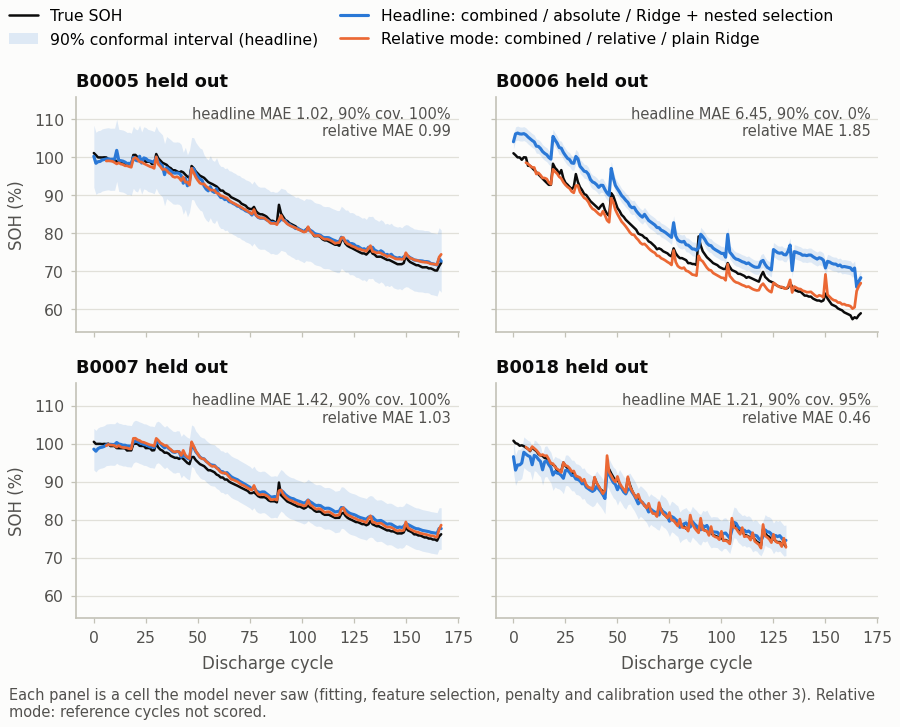
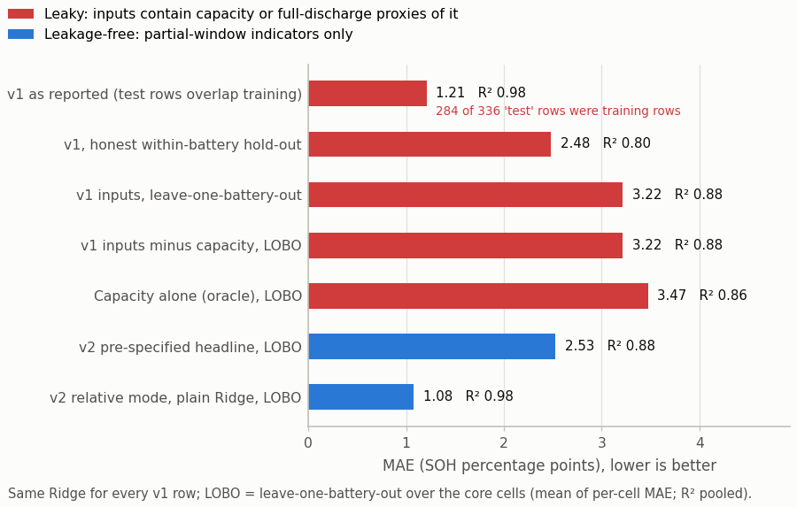
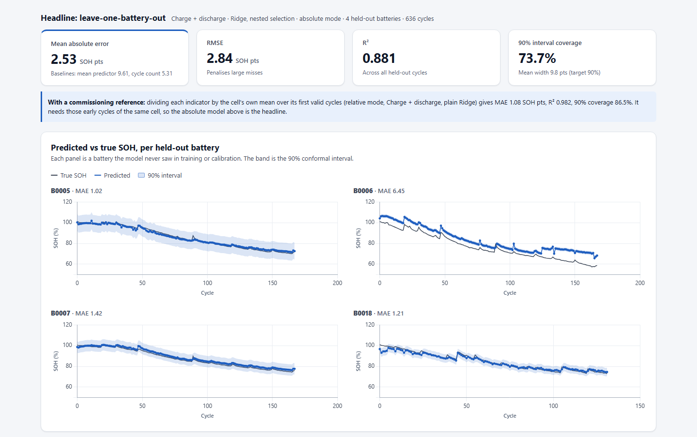
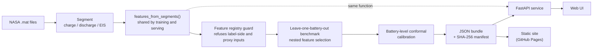
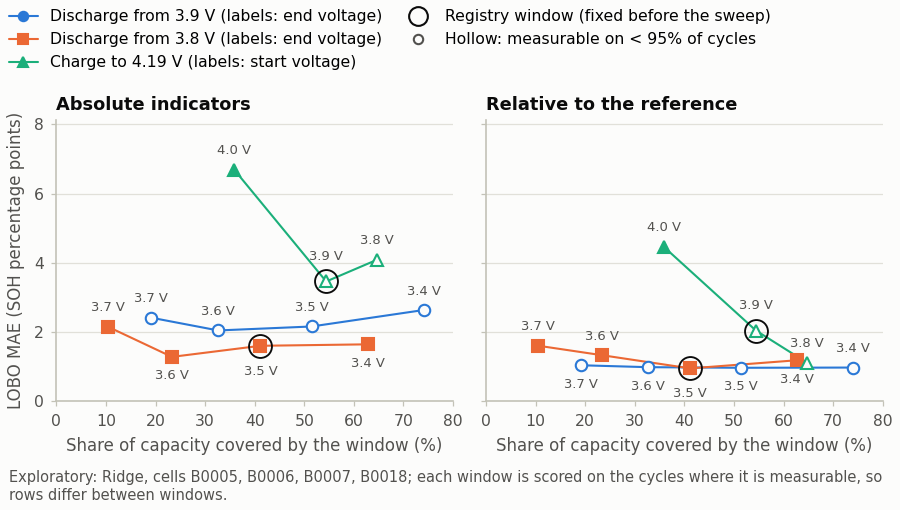

# Battery State-of-Health Estimation from Partial Cycles

Estimates how much capacity a lithium-ion cell has left (its state of health, SOH) from part of
a charge or discharge, instead of a full capacity test that takes hours and takes the cell out
of service, and measures the error on batteries the model has never seen.

[](pyproject.toml)
[](LICENSE)
[](pyproject.toml)
[](pyproject.toml)
[](tests)

<!--
  After the repository is pushed, add the live badges here (replace OWNER/REPO):
  [](https://github.com/OWNER/REPO/actions/workflows/ci.yml)
  [](https://OWNER.github.io/REPO/)
-->

**[Leakage audit](docs/LEAKAGE_AUDIT.md) · [Walkthrough notebook](notebooks/01_walkthrough.ipynb) · [Full results](docs/RESULTS.md) · [Model card](docs/MODEL_CARD.md)**

## What this project demonstrates

- **Finding and fixing target leakage.** The first version of this project (frozen under
  [`legacy/`](legacy/README.md)) reported R² ≈ 0.96. An audit showed that the label's
  numerator, capacity, was a model input, that the remaining inputs rebuilt it
  (leave-one-battery-out R² 0.99498), and that 284 of the 336 test rows were training rows.
  `soh audit` reproduces each mechanism from the committed data, and guards written as code (a
  feature registry, `check_no_leakage`, `assert_disjoint` on every fold, a request schema that
  rejects label-side inputs) turn each of these mistakes into an error.
- **Evaluation on batteries the model has never seen.** Every result is leave-one-battery-out
  on four NASA reference cells, with a 12-cell, three-condition extension. Feature selection
  and the ridge penalty are chosen, and the intervals calibrated, inside each training fold by
  an inner leave-one-battery-out loop (nested selection), so a held-out cell never shapes its
  own model.
- **A headline reported as specified.** The headline configuration was pre-specified in the
  config before its own result was computed ([what that does and does not
  guarantee](#pre-specified-headline)). Its MAE is 2.53 SOH points, against 9.61 for the
  training mean and 5.30 for a cycle-count model. Three of the four unseen cells are estimated
  within about 1.0-1.4 points; the fourth, B0006 (MAE 6.45), is
  [analysed](#failure-analysis-b0006) rather than tuned away. With a commissioning record of
  each cell (relative mode, same nested procedure) the MAE is 1.02.
- **Uncertainty checked, not assumed.** Battery-level conformal intervals at nominal 90 % cover
  74 % of a held-out cell's cycles on average (0 % for B0006) and 93 % with a commissioning
  record. Coverage is measured on held-out cells and reported per cell.
- **A deployable service.** A FastAPI service and web UI in a non-root Docker image with a
  read-only root filesystem. Models are pickle-free JSON bundles verified against a SHA-256
  manifest at start-up; one feature function, `features_from_segments`, builds the training
  table and serves raw-cycle requests; a static GitHub Pages build evaluates the same bundles in
  the browser and is tested against the API.
- **Engineering hygiene.** `mypy --strict`, ruff, and tests across unit, API, integration and
  end-to-end suites; CI on Linux and Windows that also re-runs the leakage audit and a quick
  benchmark from the committed data.


*The Estimate tab on a real NASA cycle: raw charge and discharge curves with the measurement
windows shaded, the estimate with its 90 % interval next to the measured SOH, and the exact
contribution of each indicator. The shipped models were trained on all four demo cells, so the
error shown for a demo cycle is in-sample, not a measure of accuracy on new cells; the UI says
so, and for the headline model it also shows the held-out leave-one-battery-out estimate of the
same cycle. Held-out results are below.*

**Contents:**
[Results at a glance](#results-at-a-glance) ·
[Leakage audit](#why-this-project-exists-the-leakage-audit) ·
[Quickstart](#quickstart) ·
[How it works](#how-it-works) ·
[Results in detail](#results-in-detail) ·
[API](#api-example) ·
[Engineering notes](#engineering-notes) ·
[Limitations](#limitations) ·
[Layout](#repository-layout) ·
[Roadmap](#roadmap) ·
[Data and citation](#data-and-citation) ·
[Docs](#documentation)

## Results at a glance

Four NASA reference cells (B0005, B0006, B0007, B0018), each held out in turn. MAE is in SOH
percentage points, averaged over the held-out cells; R² is pooled over all held-out
predictions; coverage is the share of a held-out cell's cycles inside the nominal 90 %
conformal interval, averaged over cells.

<!-- BEGIN:RESULTS -->
| Leave-one-battery-out, 4 core cells | MAE (SOH pts) | R2 (pooled) | 90% coverage | Note |
| --- | ---: | ---: | ---: | --- |
| Pre-specified headline: `combined` / absolute / `ridge_nfs` | **2.53** | 0.881 | 73.7% | worst cell B0006: 6.45 |
| Relative mode, nested selection (commissioning reference): `combined` / relative / `ridge_nfs` | 1.02 | 0.986 | 92.7% | worst cell B0006: 1.26 |
| Discharge window only: `discharge` / absolute / `ridge` | 1.65 | 0.965 | 84.4% | worst cell B0006: 2.66 |
| Training mean | 9.61 | -0.121 | - | baseline |
| Cycle count only | 5.30 | 0.653 | - | baseline |
| **LEAKY:** Capacity oracle | 3.47 | 0.857 | - | uses the label numerator - sanity check only |

Full tables, per-cell results and provenance: [docs/RESULTS.md](docs/RESULTS.md) (generated by `soh report`).
<!-- END:RESULTS -->

The relative-mode row is Ridge with nested selection (`ridge_nfs`), the procedure behind the
shipped relative bundle; the figure below and the audit table use plain Ridge in relative mode
(MAE 1.08, 87 % coverage). The discharge-only row is plain Ridge; the shipped discharge bundle
uses nested selection and scores 1.71 (84 % coverage).



*Each panel is one battery held out of training. Three cells are tracked within about 1-1.5
SOH points; B0006, which ages further than any training cell, is over-estimated by about 6
points ([analysis below](#failure-analysis-b0006)). Blue: the pre-specified headline with its
90 % conformal band. Orange: relative mode with plain Ridge, which needs a commissioning record.*

## Why this project exists: the leakage audit

v1 defined `SOH = 100 * capacity / C0` and then used `capacity` as a model input. Removing
that column was not enough: v1's other inputs were whole-record statistics that rebuild
capacity. Its documented test set also reused training rows. `soh audit` reproduces each
mechanism from the committed data with the same Ridge model v2 uses:



<!-- BEGIN:AUDIT -->
| Evaluation | MAE | R² |
| --- | ---: | ---: |
| v1 as reported (test rows overlap training) † | 1.21 | 0.977 |
| v1, honest within-battery hold-out † | 2.48 | 0.801 |
| v1 inputs, leave-one-battery-out † | 3.22 | 0.878 |
| v1 inputs minus capacity, LOBO † | 3.22 | 0.883 |
| Capacity alone (oracle), LOBO † | 3.47 | 0.857 |
| v2 pre-specified headline, LOBO | 2.53 | 0.881 |
| v2 same inputs, plain Ridge, LOBO | 2.60 | 0.898 |
| v2 discharge window only, LOBO | 1.65 | 0.965 |
| v2 relative mode, plain Ridge, LOBO | 1.08 | 0.982 |

† Leaky: the inputs contain capacity (the label numerator) or full-discharge proxies of it. MAE in SOH percentage points (LOBO rows: mean over held-out cells); R² pooled over all evaluated cycles. Protocols and categories: [docs/RESULTS.md](docs/RESULTS.md#leakage-audit-v1-vs-v2).
<!-- END:AUDIT -->

Within one cell, SOH against capacity has R² = 1.0. Without capacity, the remaining v1
inputs still rebuild it with leave-one-battery-out R² 0.99498, just below the 0.995 threshold
of the statistical leakage rule, so it is the feature registry, not the statistic, that refuses
them. And 284 of the 336 rows of v1's documented test set were training rows. The full story,
the code evidence and the guards that now turn each mistake into an error are in
[docs/LEAKAGE_AUDIT.md](docs/LEAKAGE_AUDIT.md).

## Quickstart

### Docker

```bash
docker compose up --build -d     # http://127.0.0.1:8000, OpenAPI docs at /docs
docker compose ps                # STATUS turns (healthy) once the model bundles are verified
```

Or without Compose, with the same restrictions (one command per line, so this also works in
Windows PowerShell 5.1):

```bash
docker build -t battery-soh .
docker run --rm -p 127.0.0.1:8000:8000 --read-only --tmpfs /tmp --cap-drop ALL --security-opt no-new-privileges battery-soh
```

### Local install

Python 3.11 or 3.12. On Linux or macOS (Debian and Ubuntu need the `python3.11-venv` package
for the first line):

```bash
python3.11 -m venv .venv          # or python3.12
source .venv/bin/activate
python -m pip install -e ".[dev]" -c requirements/constraints.txt
export OMP_NUM_THREADS=1          # avoids OpenMP oversubscription in scikit-learn
soh info                          # version and where data, models and reports live
```

On Windows (PowerShell):

```powershell
py -3.11 -m venv .venv
.\.venv\Scripts\Activate.ps1     # if blocked: Set-ExecutionPolicy -Scope CurrentUser RemoteSigned
python -m pip install -e ".[dev]" -c requirements/constraints.txt
$env:OMP_NUM_THREADS = "1"       # avoids OpenMP oversubscription in scikit-learn
$env:PYTHONIOENCODING = "utf-8"
soh info
```

`requirements/constraints.txt` pins the library versions that produced the committed results;
`summary.json` records them under `provenance` (Python 3.11.9, NumPy 2.4.4, pandas 3.0.2,
SciPy 1.17.1, scikit-learn 1.8.0). Byte-exact reproduction of the committed reports needs those
versions. With other versions the linear models and the baselines reproduce exactly, but tree
ensembles (HGB, random forest) can differ slightly. `make` is optional; every target in the
[Makefile](Makefile) wraps one `soh` command.

### Reproduce the results from the committed data

The per-cycle feature table ([`data/processed/nasa_features.csv`](data/processed/README.md),
0.66 MB, SHA-256 in its sidecar) is committed, so no download is needed:

```bash
soh audit                  # v1 leakage audit                 -> reports/audit/        (seconds)
soh benchmark --quick      # headline spec + baselines         -> reports/benchmark/quick/ (about a minute)
soh benchmark              # full benchmark, all experiments   -> reports/benchmark/    (tens of minutes)
soh train                  # JSON model bundles + model cards  -> artifacts/models/
soh report                 # figures + docs/RESULTS.md
soh serve                  # API + web UI
```

The committed full benchmark took about 9 minutes of wall time (537 s, `runtime_s` in
`summary.json`) on a multi-core workstation; expect more on a laptop or a busy machine. With the pinned library versions, reruns reproduce every file
except the timestamp and the run time.

### Full rebuild from raw data

```bash
soh data download          # official NASA archive (~200 MB), SHA-256 verified -> data/raw/nasa/
soh data build             # -> data/processed/nasa_features.csv + .meta.json (~40 s)
soh demo-assets            # downsampled demo cycles for the web UI -> artifacts/demo/
```

`make reproduce` runs the whole chain. The raw data also enables the window-sweep
experiment; without it the committed `window_sweep.json` is reused.

### Web UI and static demo

```bash
soh serve                                   # API + UI on http://127.0.0.1:8000
soh export-static --out-dir site            # backend-free build for GitHub Pages
python -m http.server 8080 --directory site # preview it on http://127.0.0.1:8080
```

The web UI has four tabs. **Estimate** picks a real NASA cycle, shows the raw voltage curves
with the measurement windows shaded, the extracted indicators, the estimate with its interval
next to the true SOH, the exact per-feature contributions and a training-domain check; it
also accepts manual indicator values or a CSV of a partial cycle. **Benchmark**,
**Leakage audit** and **Model card** render the committed results.



The static build evaluates the exported JSON model bundles in the browser and serves the
precomputed benchmark, audit and demo cycles; raw-array feature extraction (CSV upload)
needs the API. [`.github/workflows/pages.yml`](.github/workflows/pages.yml) publishes it from
`main` once CI has passed (see [DEPLOYMENT](docs/DEPLOYMENT.md#github-pages-static-demo)).

## How it works



1. **Segments.** The loader turns each `.mat` record into typed charge, discharge and
   impedance segments; every cell's protocol is registered with an explicit inclusion rule
   (4 core cells, 12 in the multi-condition set).
2. **Health indicators.** One function, `features_from_segments`, computes every indicator
   from (possibly partial) raw arrays. It builds the training table and serves
   `POST /v1/soh/estimate-from-cycle`, so training and serving cannot drift apart.
3. **Registry guard.** Every feature declares when it becomes measurable and whether it leaks
   the label. Feature sets with label-side or proxy members are refused, and the benchmark
   additionally checks every set statistically.
4. **Evaluation.** Whole cells are held out. Feature selection and the ridge penalty are
   chosen inside each training fold by an inner leave-one-battery-out loop.
5. **Uncertainty.** Conformal half-widths come from out-of-battery residuals of the training
   cells, so they target the error on a *new cell*; whether they reach their nominal coverage
   is measured on held-out cells.
6. **Artifacts.** Production models are plain JSON (coefficients, scaler, conformal
   half-widths, domain statistics) listed in a SHA-256 manifest; the API and the browser both
   evaluate them without pickle.

The indicators:

| Feature | Unit | Measured in |
|---|---|---|
| `chg_cc_time_390_419_s` | s | CC charge, 3.90 → 4.19 V |
| `chg_cv_time_s` | s | CV phase at 4.2 V, until the current falls below 0.1 A |
| `chg_ica_peak_height_ah_per_v` | Ah/V | dQ/dV of the CC charge, 3.90-4.18 V |
| `chg_ica_peak_voltage_v` | V | same |
| `chg_temp_rise_cc_c` | °C | CC charge, 3.90 → 4.19 V |
| `dis_q_380_350_ah` | Ah | discharge under load, 3.80 → 3.50 V |
| `dis_r0_ohm` | Ω | voltage step at load-on |
| `dis_temp_rise_win_c` | °C | discharge, 3.80 → 3.50 V |
| `eis_re_ohm`, `eis_rct_ohm` | Ω | latest EIS measurement before the cycle |

The multi-condition sets use the 4.00 → 4.19 V charge window plus ambient temperature and
load current. Definitions, physics and availability:
[docs/METHODOLOGY.md](docs/METHODOLOGY.md#6-health-indicators).

## Results in detail

All numbers are leave-one-battery-out, in SOH percentage points, from
[`summary.json`](reports/benchmark/summary.json): MAE, bias and coverage are averaged over
held-out cells, R² is pooled. The generated report [docs/RESULTS.md](docs/RESULTS.md) has the
114-row leaderboard, coverage tables and every figure.

### Pre-specified headline

`combined` indicators, absolute mode, Ridge with nested feature selection (`ridge_nfs`). This
specification was written into [`configs/benchmark.yaml`](configs/benchmark.yaml) before any
`ridge_nfs` result was computed, and it is reported unchanged. It was not chosen blind to these
four cells: the indicator windows, feature sets and relative mode come from an audit prototype
that had already scored plain Ridge leave-one-battery-out on them (MAE about 1.6-1.7), and
plain-Ridge results for this same `combined`/absolute specification on the v2 table (2.60;
B0006 5.83), the no-CV-time ablation and relative mode were known when the headline was fixed.
The declaration guards against picking the best of the 114 leaderboard rows afterwards; it does
not make the design independent of these cells.

| Held-out cell | Cycles | MAE | Bias | 90 % coverage | Mean 90 % width |
|---|---:|---:|---:|---:|---:|
| B0005 | 168 | 1.02 | -0.04 | 1.00 | 16.38 |
| B0006 | 168 | **6.45** | **+6.42** | **0.00** | 3.69 |
| B0007 | 168 | 1.42 | +1.29 | 1.00 | 10.96 |
| B0018 | 132 | 1.21 | -0.40 | 0.95 | 8.08 |
| **Mean** | | **2.53** | +1.82 | **0.74** | 9.78 |

### Failure analysis: B0006

Three cells are estimated to within about 1.0-1.4 points; one is not. The cause is
specific and measurable:

1. **Extrapolation.** B0006 fades to 57.3 % SOH; the other three cells never go below 70.1 %.
   62 of its 168 cycles lie below anything the model saw in training.
2. **A cell-specific offset that inner validation cannot see.** B0006's constant-voltage
   charge phase is longer from the start: 4,111 s at commissioning against 3,738-3,928 s for
   the other cells. With B0006 held out, the inner leave-one-battery-out loop over the other
   three cells keeps the CV-time feature (inner MAE 0.66), and it misleads on B0006. A
   post-hoc ablation without it, labelled as such and not a result, lowers B0006's error of
   plain Ridge from 5.83 to 2.45. With all four cells available, the same selection drops
   the feature first, so the shipped bundle does not use it.
3. **Intervals.** In the B0006 fold the conformal half-width comes from three cells that agree
   with each other, so the band is narrowest (3.69 points) exactly where the error is largest:
   0 % coverage. Whether a new cell is exchangeable with the calibration cells cannot be
   checked with four cells, and with three calibration cells there is no battery-level
   finite-sample guarantee in any case (a 90 % guarantee needs at least nine).

The headline is reported unchanged. Picking a better-looking row instead, such as the best
absolute-mode row that is not a post-hoc ablation (elastic net on the discharge window, 1.50)
or the best non-leaky row overall (0.99, relative mode with EIS), would be model selection on
the test cells.

### Relative mode

Dividing each indicator by the cell's own mean over its first five valid cycles removes
offsets such as B0006's (reference cycles are excluded from training, calibration and
scoring):

| Configuration | MAE | Worst cell | 90 % coverage |
|---|---:|---:|---:|
| Combined, Ridge with nested selection (the shipped relative bundle's procedure) | 1.02 | 1.26 | 0.93 |
| Combined, plain Ridge (the trajectory figure and the audit table) | 1.08 | 1.85 | 0.87 |
| Discharge window only, Ridge with nested selection | 0.99 | 1.32 | 0.94 |
| Absolute headline on the same non-reference cycles | 2.49 | | |

The price is a commissioning record: the first few cycles of the cell, under the same
protocol. The reference cycles are the first five QC-valid ones, and QC validity is decided
from the measured capacity, which a deployed system would replace by its own commissioning
check; every cycle of the four core cells passes QC, so the core results do not depend on it.

### Twelve cells, three operating conditions

Extended set: the core cells plus B0036 (2 A, 24 °C), B0029-B0032 (4 A, 43 °C) and
B0046-B0048 (1 A, 4 °C), `combined_ext` indicators in relative mode, leave-one-battery-out.
The 95 % intervals come from a bootstrap over cells: they describe the between-cell spread of
the per-cell errors of the fitted models (no refitting per resample) and ignore that cells
cluster by operating condition, so treat them as rough.

| Model | MAE [95 % CI] |
|---|---|
| Gradient boosting (HGB) | 1.37 [1.02, 1.85] |
| Ridge with nested selection | 1.96 [1.40, 2.61] |
| Ridge | 2.07 [1.58, 2.60] |
| Training mean | 8.09 [6.79, 9.64] |

HGB against Ridge: two-sided Wilcoxon signed-rank p = 0.042 over the 12 per-cell MAEs
(Ridge better on 4 cells). HGB was chosen as the better of two candidates on the same folds,
so a Bonferroni factor of 2 gives 0.085, and it is the only one of four such comparisons below
0.05. The comparison is also library-sensitive: under scikit-learn 1.9.1 instead of the pinned
1.8.0, HGB's numerics change and the same test gives p = 0.021 (0.042 corrected). The
difference is suggestive, not established.

Holding out a whole operating condition is much harder. In relative mode with `combined_ext`,
HGB, Ridge with nested selection and Ridge reach 2.73, 2.78 and 3.21 (GPR 6.53), against 8.20
for the training mean; with the charge-only `charge_ext` set the four models range from 4.63
to 23.14 (nested selection fails worst). In absolute mode the linear models extrapolate badly
(Ridge 21.43 with `combined_ext`, worse than the mean baseline at 8.52), and with only two
calibration conditions per fold the intervals are too wide to be useful.

### How much of a cycle is needed



An exploratory sweep over 11 voltage windows (Ridge, core cells): a 3.80 → 3.60 V discharge
window, which covers about 23 % of the capacity, gives MAE 1.28 in absolute mode; the
registry window 3.80 → 3.50 V (41 %) gives 0.95 in relative mode. The 1.28 is the best of the
11 windows scored on the same four cells, so it is optimistic, not an estimate for a new cell.
The registry windows were fixed before the sweep and are not selected from it. Details:
[METHODOLOGY](docs/METHODOLOGY.md#13-window-sweep).

More figures: [coverage](reports/figures/coverage.png),
[leaderboard](reports/figures/leaderboard.png),
[indicators vs SOH](reports/figures/indicators_vs_soh.png),
[extended set](reports/figures/extended_lobo.png),
[feature contributions](reports/figures/feature_contributions.png).

## API example

```bash
curl -s http://127.0.0.1:8000/v1/soh/estimate \
  -H 'Content-Type: application/json' \
  -d @.github/fixtures/sample_estimate_request.json
```

In Windows PowerShell, call `curl.exe` (plain `curl` is an alias of `Invoke-WebRequest` in
PowerShell 5.1) or use `Invoke-RestMethod`:

```powershell
curl.exe -s http://127.0.0.1:8000/v1/soh/estimate -H "Content-Type: application/json" --data "@.github/fixtures/sample_estimate_request.json"
Invoke-RestMethod -Method Post -Uri http://127.0.0.1:8000/v1/soh/estimate -ContentType "application/json" -InFile .github/fixtures/sample_estimate_request.json
```

The request carries the eight `combined` indicators of B0005 at discharge cycle 80
([fixture](.github/fixtures/sample_estimate_request.json)); the measured SOH of that cycle is
84.98 %. Response (numbers rounded, `method` shortened):

```json
{
  "model_id": "discharge-absolute-ridge",
  "soh_pct": 84.14,
  "interval": {"lower": 80.78, "upper": 87.51, "confidence": 0.9, "method": "group conformal (cv): ..."},
  "base_value": 83.60,
  "contributions": [
    {"feature": "dis_q_380_350_ah", "value": 0.6619, "contribution": -0.10},
    {"feature": "dis_r0_ohm", "value": 0.1011, "contribution": 0.65}
  ],
  "domain": {"in_domain": true, "out_of_range": [], "mahalanobis": 0.72, "threshold": 2.91, "missing": []},
  "warnings": []
}
```

The service chose the discharge bundle because it has the lowest leave-one-battery-out MAE
among the bundles whose inputs were all present; `base_value` plus the contributions equals
`soh_pct`. B0005 is one of the training cells, so this shows the contract, not out-of-sample
accuracy.

Other endpoints: `POST /v1/soh/estimate-from-cycle` (raw arrays in, indicators and estimate
out), `POST /v1/soh/batch` (100 items by default, configurable up to 1,000),
`GET /v1/models`, `GET /v1/models/{id}`, `GET /v1/benchmark`, `GET /v1/demo/batteries`,
`GET /livez`, `GET /readyz`, `GET /metrics`, OpenAPI at `/docs`. Errors are RFC 7807
`application/problem+json` with a request id. Full contract: [docs/API.md](docs/API.md).

## Engineering notes

- **Train/serve parity by construction.** One function, `features_from_segments`, builds the
  training table and serves `/v1/soh/estimate-from-cycle`, and the API's indicator schema is
  generated from the feature registry, so validation bounds and OpenAPI documentation cannot
  drift from the training code. The browser's static mode re-implements only the linear-bundle
  arithmetic; an end-to-end test runs it in Node.js and requires the API's answers, including
  its validation errors.
- **Leakage guards as code.** A feature registry with availability and leakage risk;
  `get_feature_set` refuses leaky sets; `check_no_leakage` runs on every benchmark feature
  set; `assert_disjoint` runs on every fold; the API schema rejects label-side inputs (422)
  and the model registry refuses bundles that use them. `soh audit` shows each guard firing
  on the v1 setup.
- **Provenance.** The headline specification and the nested-selection procedure are written in
  the config, post-hoc feature sets are flagged in every output, and `summary.json` records the
  SHA-256 of the config and of the data plus the library versions. The feature table is
  byte-identical on rebuild, with a SHA-256 sidecar; bundles and the demo archive are
  byte-deterministic.
- **Models as data, loaded fail-closed.** Bundles are JSON evaluated with NumPy, no pickle.
  The API verifies the SHA-256 manifest at start-up: one hash mismatch and no model is served,
  `/readyz` stays 503; a malformed bundle is skipped with an error instead of crashing the
  start-up. Every estimate carries exact linear attributions that sum to the prediction and a
  training-domain check (feature ranges and a Mahalanobis distance under a shrunk covariance).
- **Service defences.** Strict Pydantic validation (finite numbers, physical ranges, unknown
  fields rejected), 413 before parsing, a batch cap, RFC 7807 errors without stack traces, a
  strict Content-Security-Policy, request ids, structured JSON logs, Prometheus RED metrics,
  ETag caching of the read-only result endpoints and no outbound calls. The image runs as a
  non-root user on a read-only root filesystem, from a base image pinned by digest, with its
  runtime dependencies installed from a hashed lock file.
- **Typing, tests and CI.** The package passes `mypy --strict` and ships a `py.typed` marker.
  1,048 tests are collected (729 unit, 237 API, 80 integration, 2 end-to-end); feature
  extractors are tested against a synthetic cell simulator with analytic ground truth, and
  Hypothesis property tests cover the API input validation, the conformal ranks and the
  capacity QC rule. CI runs ruff and mypy, pytest on Ubuntu (Python 3.11, 3.12) and Windows
  (3.11), the audit and the quick benchmark from the committed data, and a Docker build that is
  started read-only and smoke-tested. Actions are pinned to commit SHAs, and the Pages and
  release workflows (GHCR image with an SBOM and provenance) run only after CI has passed.

## Limitations

- **Few cells.** The headline rests on four cells of one chemistry and form factor, cycled by
  one laboratory; the extended set has twelve cells in three conditions. Per-cell results
  vary from 1.02 to 6.45 MAE, and no model difference on the core set can be statistically
  significant (with four paired cells the smallest attainable Wilcoxon p-value is 0.125).
- **Interval coverage is measured, not guaranteed.** With three calibration cells per fold
  there is no battery-level finite-sample guarantee (a 90 % guarantee would need at least nine
  exchangeable cells). Coverage at nominal 90 % is 0.74 in the headline (0.00 for B0006), and
  battery-level exchangeability cannot be verified from four cells.
- **Relative mode needs a commissioning record** under the same protocol; it does not apply
  to cells of unknown history.
- **Protocol-specific windows.** The indicators assume NASA's CC-CV charge (1.5 A to 4.2 V)
  and a constant discharge load. Under 4 A at 43 °C the loaded voltage of B0032 starts below
  3.80 V, so its discharge window never exists; other chargers and load profiles would need
  their windows re-derived and re-validated.
- **New operating conditions are not supported.** Leave-one-condition-out error is 2.7-3.2
  for HGB and the two Ridge variants with `combined_ext` in relative mode (GPR 6.53; the
  charge-only set 4.6-23.1), and absolute-mode linear models fail outright.
- **Label definition.** SOH is relative to each cell's own initial capacity. A rated-capacity
  label (`soh_rated_pct`) is in the table but is not benchmarked.
- **Not a battery-management function.** This is a research demonstration on laboratory data,
  not a safety-certified estimator.
- **The pre-specification is in-repository and not blind.** It is not timestamped by an
  external registry, and the design was informed by earlier plain-Ridge results on the same
  cells ([disclosure](#pre-specified-headline)). The configuration hash shows which
  configuration produced `summary.json`, not when it was written.

## Repository layout

```text
.
├── src/battery_soh/        library, CLI and API (typed, mypy --strict)
│   ├── data/               .mat loader, cell protocol registry + inclusion rule, download
│   ├── features/           registry, charge / discharge / ICA / EIS extractors, table builder
│   ├── evaluation/         splits, metrics, baselines, leakage checks, nested selection, audit
│   │   └── benchmark/      benchmark package: config, frames, fitting, runner, report, sweep
│   ├── models/             model zoo, JSON bundle export and NumPy runtime
│   ├── uncertainty/        battery-grouped conformal prediction
│   ├── reporting/          figures and the generated results document
│   ├── api/                FastAPI app, schemas, model registry, middleware, static export
│   ├── labels.py, qc.py    SOH labels and capacity quality control
│   ├── training.py         production bundles and model cards
│   └── cli.py              the `soh` command
├── tests/                  unit/, api/, integration/, e2e/ (static-site parity, needs Node.js)
├── configs/benchmark.yaml  experiments, pre-specified headline, production specs
├── data/processed/         committed feature table + SHA-256 sidecar (raw data is not committed)
├── reports/                benchmark/, audit/, figures/ (generated, committed)
├── artifacts/              models/ (JSON bundles, MANIFEST.json, model cards), demo/
├── notebooks/              executed walkthrough notebook
├── frontend/               static web UI, no build step
├── docs/                   methodology, audit, data and model cards, API, deployment, ADRs
├── requirements/           pinned constraints and the hashed runtime lock for the image
├── legacy/                 frozen v1, kept as evidence for the audit (not packaged)
├── Dockerfile, docker-compose.yml, Makefile
└── .github/workflows/      ci.yml, pages.yml, release.yml
```

## Roadmap

- More cells and chemistries from public datasets with partial-window protocols, to test
  whether the indicators transfer.
- Hierarchical models with per-cell random offsets, as a principled alternative to
  commissioning references.
- Conformal methods that account for covariate shift between cells (weighted or
  condition-conditional calibration), evaluated on the extended set.
- A rated-capacity benchmark (`soh_rated_pct`) next to the own-reference one.
- Indicators that do not depend on the charger protocol, such as rest-period voltage
  relaxation.

## Data and citation

Data: NASA PCoE Battery Data Set, B. Saha and K. Goebel (2007), *Battery Data Set*, NASA
Ames Prognostics Data Repository, NASA Ames Research Center, Moffett Field, CA. The raw files
are not redistributed here: `soh data download` fetches them from the official archive and
verifies a pinned SHA-256 (see [data/raw/README.md](data/raw/README.md)). The derived
per-cycle table in `data/processed/` is committed so that results can be reproduced without
the download. Please cite the dataset when you use this project; citation metadata for the
software is in [CITATION.cff](CITATION.cff).

Author: Preran Sai Yarramasu.

## Documentation

| Document | Contents |
|---|---|
| [LEAKAGE_AUDIT](docs/LEAKAGE_AUDIT.md) | What v1 got wrong, reproduced numbers, the guards |
| [METHODOLOGY](docs/METHODOLOGY.md) | Task, labels, inclusion rule, indicators, protocol, conformal, statistics |
| [RESULTS](docs/RESULTS.md) | Generated by `soh report`: every table and figure |
| [Walkthrough notebook](notebooks/01_walkthrough.ipynb) | An executed tour: data, the leakage trap, evaluation, uncertainty, the shipped model |
| [DATA_CARD](docs/DATA_CARD.md) | Datasheet of the processed feature table |
| [MODEL_CARD](docs/MODEL_CARD.md) | The shipped model bundles |
| [ARCHITECTURE](docs/ARCHITECTURE.md) | Modules, data and artifact flow, design trade-offs |
| [API](docs/API.md) | Endpoint contract, errors, limits, settings |
| [DEPLOYMENT](docs/DEPLOYMENT.md) | Docker, GitHub Pages, GHCR, reverse proxy, PaaS notes |
| [ADRs](docs/adr/README.md) | Architecture decision records |
| [CHANGELOG](CHANGELOG.md), [CONTRIBUTING](CONTRIBUTING.md), [SECURITY](SECURITY.md) | Project process |

## License

[MIT](LICENSE). The vendored Chart.js in `frontend/assets/vendor/` is MIT-licensed by its
authors ([license](frontend/assets/vendor/chart.js.LICENSE.md)).
