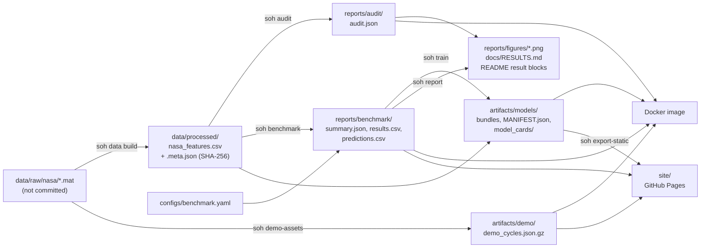
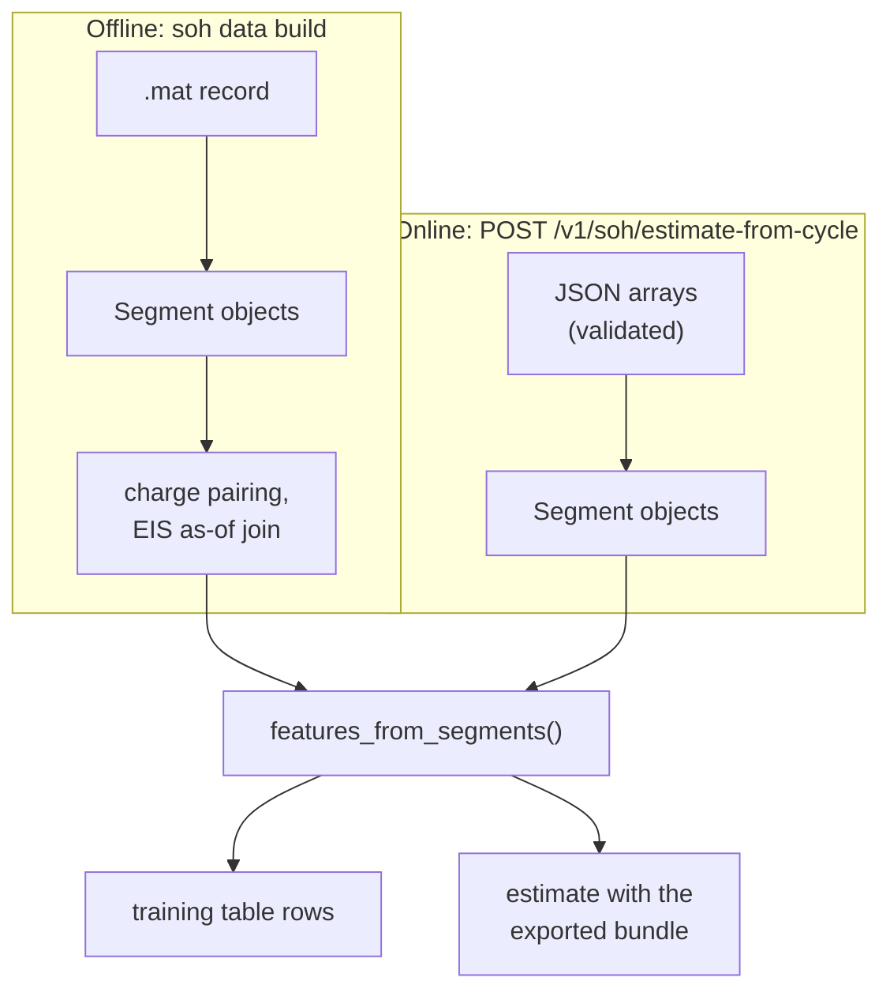
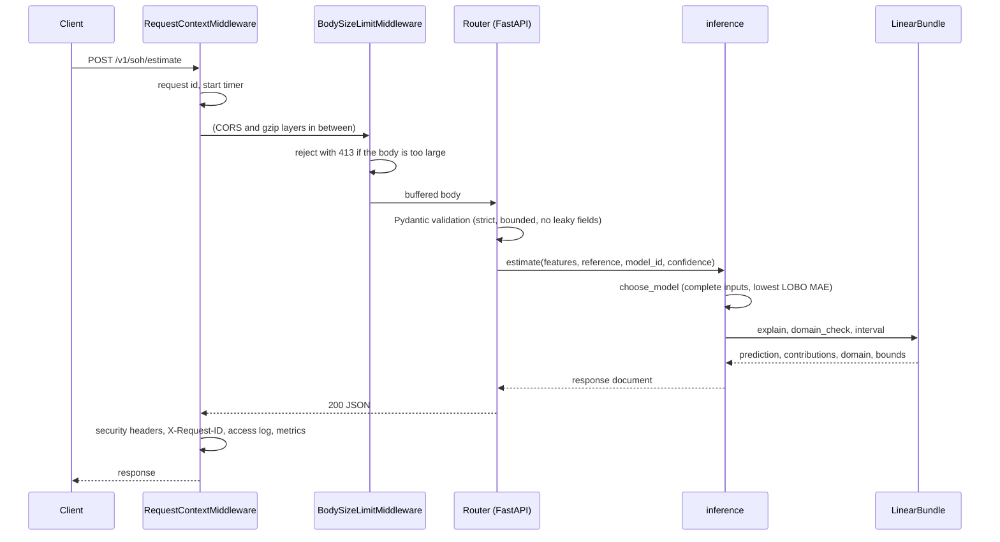

# Architecture

The project is one Python package, `battery_soh`, with a thin CLI (`soh`), a FastAPI service
and a static web UI. Offline commands turn raw NASA files into a committed feature table,
evaluate models on it, and export the production models as JSON; the service and the web UI
only read those artifacts.

## Contents

- [Module map](#module-map)
- [Data and artifact flow](#data-and-artifact-flow)
- [Train/serve parity](#trainserve-parity)
- [Serving path](#serving-path)
- [Where the leakage rules live](#where-the-leakage-rules-live)
- [Design decisions and trade-offs](#design-decisions-and-trade-offs)

## Module map

```mermaid
flowchart TB
    subgraph data["battery_soh.data"]
        schema["schema<br/>Segment, BatteryRecord"]
        nasa["nasa<br/>.mat loader"]
        protocols["protocols<br/>34 cells + inclusion rule"]
        download["download<br/>SHA-256 verified"]
    end
    subgraph labels_qc["labels and QC"]
        qc["qc<br/>capacity flags"]
        labels["labels<br/>soh_pct, soh_rated_pct"]
    end
    subgraph features["battery_soh.features"]
        registry["registry<br/>units, availability, leakage risk"]
        extract["extract<br/>features_from_segments()"]
        extractors["charge, discharge, ica, impedance"]
        build["build<br/>feature table"]
        relative["relative<br/>commissioning reference"]
    end
    subgraph evaluation["battery_soh.evaluation"]
        splits["splits<br/>LOBO, assert_disjoint"]
        leakage["leakage<br/>check_no_leakage"]
        nested["nested<br/>ridge_nfs"]
        benchmark["benchmark<br/>package: runner, frames,<br/>fitting, report, window sweep"]
        audit["audit"]
    end
    subgraph modelling["models and uncertainty"]
        zoo["models.zoo"]
        bundle["models.linear_bundle<br/>JSON export, NumPy runtime"]
        conformal["uncertainty.conformal"]
    end
    training["training<br/>production bundles"]
    reporting["reporting<br/>figures, RESULTS.md"]
    api["api<br/>FastAPI service, static export"]
    cli["cli<br/>soh ..."]

    nasa --> schema
    protocols --> labels
    qc --> labels
    build --> extract
    extract --> extractors
    build --> labels
    build --> nasa
    benchmark --> splits
    benchmark --> leakage
    benchmark --> nested
    benchmark --> conformal
    benchmark --> zoo
    benchmark --> relative
    benchmark --> registry
    audit --> benchmark
    training --> benchmark
    training --> bundle
    training --> conformal
    api --> bundle
    api --> extract
    api --> relative
    reporting --> benchmark
    cli --> build
    cli --> benchmark
    cli --> audit
    cli --> training
    cli --> reporting
    cli --> api
```

| Package / module | Responsibility |
|---|---|
| `data.schema` | Frozen dataclasses for one operation (`Segment`) and one cell (`BatteryRecord`). |
| `data.nasa` | Robust `.mat` parsing, de-duplication of the two copies of B0025-B0028. |
| `data.protocols` | Test protocol of every cell from the dataset READMEs, checked against the data; the five-criterion inclusion rule; `CORE_BATTERIES`, `EXTENDED_BATTERIES`. |
| `data.download` | Stdlib-only download with SHA-256 verification and safe nested-zip extraction. The only network code in the package. |
| `qc`, `labels` | Capacity quality control and the SOH labels. |
| `features.registry` | Single source of truth for every input: unit, family, availability, leakage risk, plausible range, named feature sets. |
| `features.charge`, `discharge`, `ica`, `impedance`, `legacy` | Pure functions from a `Segment` to indicator values (NaN on failure). `legacy` reproduces v1's inputs for the audit. |
| `features.extract` | `features_from_segments`, the one entry point used by training and serving. |
| `features.build` | Cycle pairing, EIS as-of join, labels, deterministic CSV with a SHA-256 sidecar. |
| `features.relative` | Commissioning-referenced indicators, identical rules for tables and single requests. |
| `evaluation.splits`, `metrics`, `baselines` | Group splits with disjointness assertions; per-cell metrics, interval metrics, bootstrap; reference baselines. |
| `evaluation.leakage` | `leakage_report`, `check_no_leakage`. |
| `evaluation.nested` | Ridge with nested feature selection (`ridge_nfs`). |
| `evaluation.benchmark` | A subpackage that runs the experiments of `configs/benchmark.yaml`: configuration loading and hashing, data frames per experiment, model fitting, the runner, the summary report and the window sweep. |
| `evaluation.audit` | The v1 reproduction behind `soh audit`. |
| `models.zoo` | Seeded scikit-learn pipelines with the same named steps. |
| `models.linear_bundle` | JSON export verified against scikit-learn; NumPy-only prediction, attribution, interval and domain check; manifest writer and verifier. |
| `uncertainty.conformal` | Exact conformal ranks; battery-grouped `cv` and `cv_plus`. |
| `explain` | Battery-grouped permutation importance for non-linear models. |
| `synthetic` | A lumped equivalent-circuit cell simulator with analytic ground truth, used by the tests. |
| `training` | Production bundles and model cards from the benchmark's procedures. |
| `reporting` | Figures and `docs/RESULTS.md` from the JSON results. |
| `api` | App factory, settings, schemas, model registry, inference, middleware, metrics, demo store, static-site export. |
| `config`, `logs`, `cli` | Paths (`get_paths()`, overridable by environment), logging setup, the `soh` command. |
| `errors` | `BatterySohError`, the base of every exception the package defines (`BundleError`, `ManifestError`, `LeakageError`, `TrainingError`, `ProblemError`, ...). Each also keeps its built-in base (`ValueError` or `RuntimeError`), so `except ValueError` handlers still match. |

## Data and artifact flow

Everything right of the raw files is committed, so a clone can run the audit, the benchmark,
training and the service without downloading anything. Each stage records its inputs: the
feature table's sidecar holds its SHA-256 and the extractor version; `summary.json` holds the
SHA-256 of the configuration and of the feature table plus library versions; each bundle
holds the feature table's SHA-256 and the benchmark metrics of its own procedure, and
`soh train` fails if its leave-one-battery-out refits do not reproduce `results.csv`.

## Train/serve parity

The function that computes the indicators for training is the one that computes them for a
request; nothing is re-implemented in the service. The registry's plausible ranges are used
by the extractor's caller in the API (out-of-range values are dropped with a warning) and by
the request schema for `/v1/soh/estimate`. Relative mode uses one module for both the
training table (`relativize`) and requests (`apply_reference`).

The web UI's static mode is the only re-implementation: a JavaScript port of the bundle
arithmetic (imputation, standardisation, dot product, clip, interval, domain check). It does
not extract features; that needs the API.

## Serving path

At start-up the lifespan handler calls `ModelRegistry.load`: it verifies `MANIFEST.json`
(every listed file present and matching its SHA-256, names confined to the folder), reads each
listed bundle once, re-hashes the bytes it parsed and parses strict JSON (no `NaN` tokens).
A bundle that uses an unknown or leaky feature, has an unsafe model id, or is malformed in a
way the manifest cannot detect (for example a ragged precision matrix) is skipped with an
error log instead of crashing the start-up; if no bundle remains, `/readyz` stays 503. A
manifest failure (missing manifest, missing file, one hash mismatch) leaves the registry empty
and `/readyz` at 503: a modified artifact folder is treated as compromised, not as partially
usable.

Failure handling: expected client errors are `ProblemError` instances rendered as RFC 7807;
validation errors are sanitised (no input echo); any other exception becomes a generic 500
whose details go to the log under the request id.

## Where the leakage rules live

| Rule | Enforced in |
|---|---|
| No label-side or proxy feature in a model | `features.registry.get_feature_set`; `evaluation.leakage.check_no_leakage` on every benchmark set; `api.schemas` (request) and `api.registry` (bundle) |
| No row of a held-out cell in training | `evaluation.splits.assert_disjoint` and `assert_groups_disjoint` on every fold |
| No information from the future | `features.build` charge pairing and EIS as-of join |
| No test-cell information in selection or calibration | `evaluation.nested` (inner LOBO on training cells), `uncertainty.conformal` (calibration on training cells) |
| Reference cycles never scored | `features.relative` flags them; the benchmark and training exclude them |

## Design decisions and trade-offs

The significant decisions have ADRs in [docs/adr](adr/README.md). In brief:

- **Linear models in production.** The extended benchmark suggests gradient boosting is more
  accurate across conditions (MAE 1.37 against 2.07 for Ridge, not significant after
  correction, and the p-value moves with the scikit-learn version). On the core cells' absolute
  `combined` set, elastic net (2.24) and the tree ensembles (2.30) beat plain Ridge (2.60) and
  the nested-selection headline (2.53). Linear models lead in relative mode (1.02 against 1.55
  for the best tree ensemble) and on the discharge window (elastic net 1.50, Ridge 1.65, trees
  2.17 and above).
  The shipped models are Ridge because a linear model gives exact, additive explanations,
  serialises to a few kilobytes of reviewable JSON, and runs in NumPy and in the browser. A
  tree ensemble would need a different, larger artifact format.
- **JSON bundles, not pickle** ([ADR 0003](adr/0003-json-model-bundles-no-pickle.md)). Loading
  a pickle executes code; a JSON bundle is data that can be diffed in a pull request. The
  serving path imports no scikit-learn.
- **A fixed conformal half-width (`cv`), not CV+, in the bundle**
  ([ADR 0004](adr/0004-battery-level-conformal-intervals.md)). CV+ needs every fold model at
  prediction time; the fixed half-width is one number per confidence level, and the benchmark
  reports the coverage of exactly that construction.
- **Committed processed data instead of a data-versioning tool.** The table is 0.66 MB and
  deterministic; a SHA-256 sidecar and a byte-identical rebuild test give the same guarantees
  with no extra infrastructure.
- **No authentication or rate limiting in the application.** The service is read-only and
  holds no private data; access control belongs in a reverse proxy
  ([DEPLOYMENT](DEPLOYMENT.md#behind-a-reverse-proxy)). The trade-off is that a public
  instance must not be exposed without one.
- **One worker per container.** Each uvicorn worker holds its own models and its own
  Prometheus registry, so `/metrics` would describe one worker per scrape. Scaling is by
  replicas.
- **No database, no queue.** Every request is independent and computed in milliseconds of
  NumPy; state would add failure modes without a use. The read-only result endpoints
  (`/v1/benchmark`, `/v1/demo/*`) serve bytes cached per source file and answer
  `If-None-Match` with 304 ([API](API.md)).
- **Static export for the public demo.** The same UI runs against precomputed JSON on GitHub
  Pages, so the demo needs no server; the cost is that raw-array extraction is unavailable
  there.
