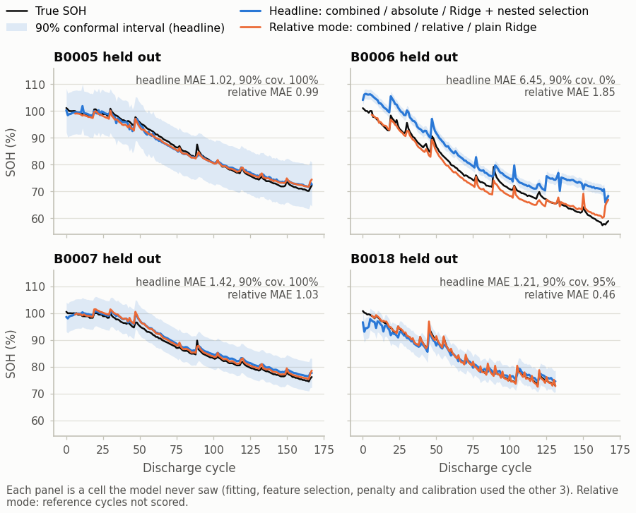
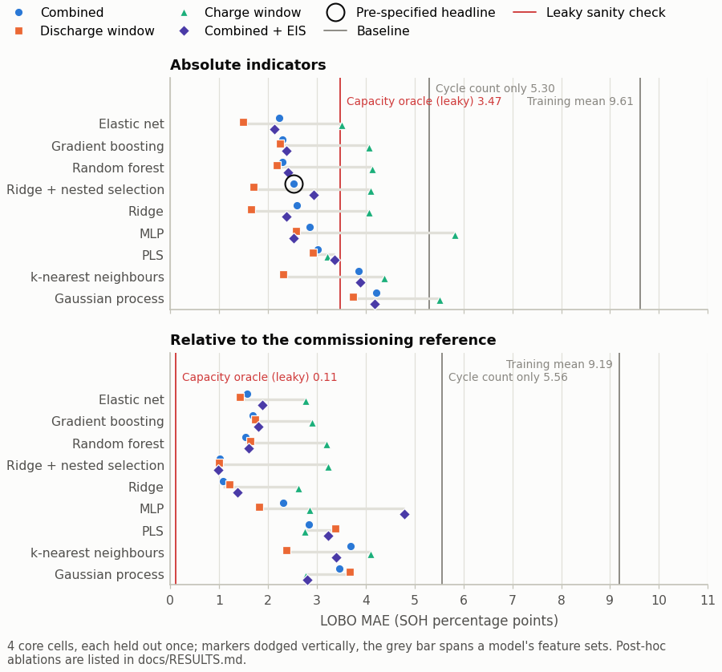
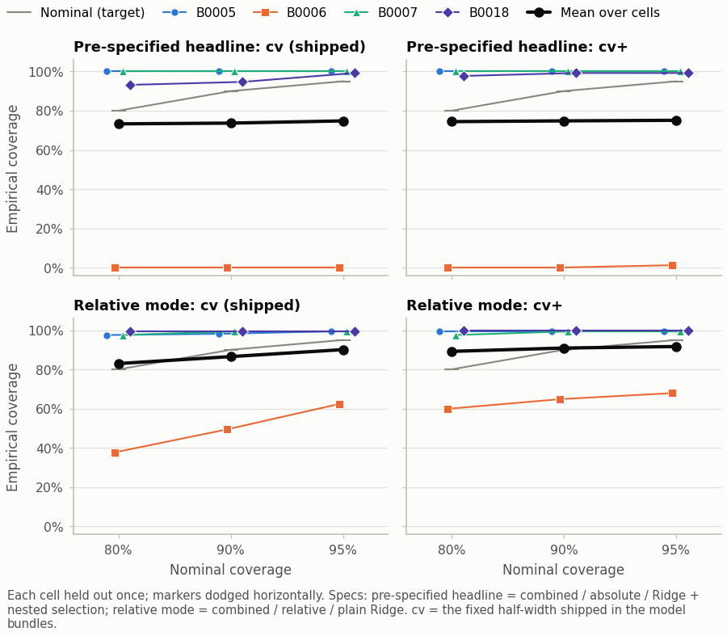
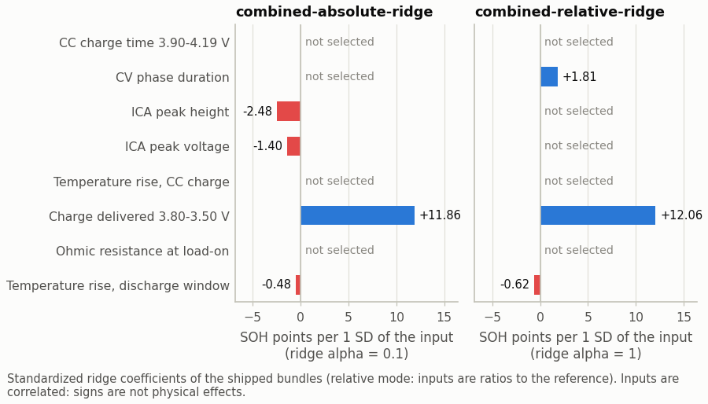
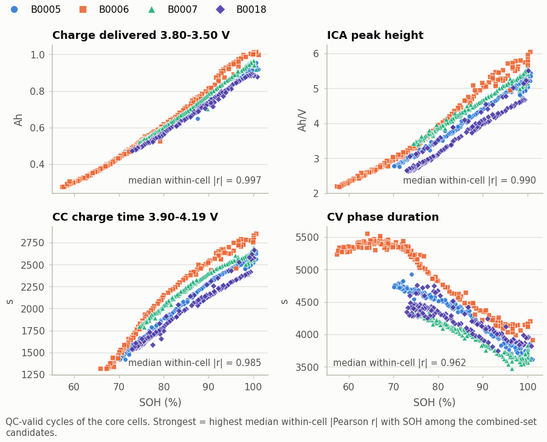
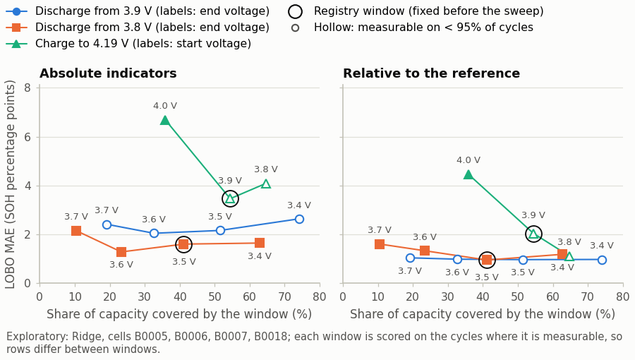
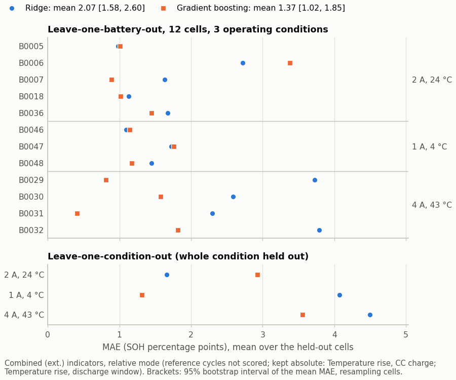
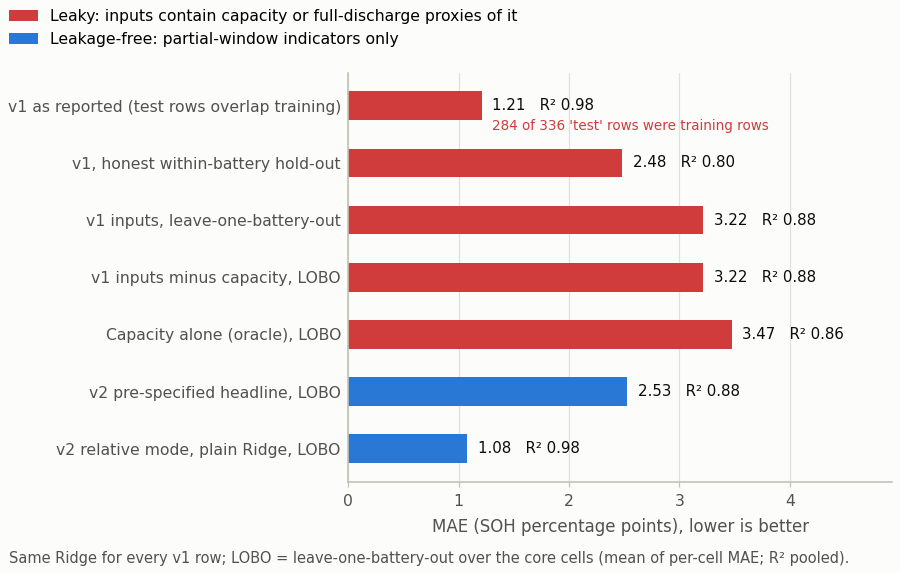

<!-- generated by `soh report` from reports/benchmark, reports/audit and artifacts/models; do not edit -->

# Results

> Generated by `soh report` from `reports/benchmark/summary.json`, `reports/audit/audit.json` and `artifacts/models`; do not edit. Regenerate with `soh benchmark && soh train && soh report`.

## Provenance

| Item | Value |
| --- | --- |
| Benchmark run (UTC) | 2026-10-14T12:03:06+00:00 |
| Benchmark config | `configs/benchmark.yaml` |
| Config SHA-256, benchmark sections | `019057651b4108da15f71ba86bd1169db8afefa373937ceb1604b5d919ccfa02` (matches the benchmark sections of the config on disk) |
| Config SHA-256, production section | `8655c7614181681cc3b05ff2b8ac91178bbce11e1a6ab3f1eb1f1b9f7d57c88b` (matches the production section on disk) |
| Feature table SHA-256 | `f6c4fb709c4810f76a71eaf3ee2b99f963e0fcc94d354dbe636ae8682333d997` (matches the feature table on disk) |
| Feature extractor version | 2.0.0 |
| Package version | 2.0.0 |
| Environment | Python 3.11.9, numpy 2.4.4, pandas 3.0.2, scipy 1.17.1, scikit-learn 1.8.0, matplotlib 3.10.8 (win32) |
| Seed | 42 |
| Benchmark runtime | 537 s |
| Audit run (UTC) | 2026-10-14T11:53:45+00:00 |
| Model bundles | 4 in `artifacts/models` (deterministic timestamp 2026-10-12T07:39:55+00:00: the feature table's build time unless `production.created_utc` fixes another, not when `soh train` ran, so reruns are byte-identical; SHA-256 in `MANIFEST.json`); trained on this benchmark run's results (same benchmark config hash) |

The two config hashes are scoped, so each changes only when something it describes changes: the benchmark hash covers `seed`, `label`, `n_reference_cycles`, `confidence_levels`, `conformal`, `nested_selection`, `headline`, `secondary`, `predictions`, `experiments`, `window_sweep`, `quick` (nested `description` text excluded); the production hash covers `production`, which only `soh train` reads. Neither covers `schema_version`, `description`, `n_jobs`, `features_csv`, `raw_dir` (file-format version, free text, worker count and file locations; the feature table's content has its own hash).

Protocol: whole batteries are held out (leave-one-battery-out, LOBO); feature selection, penalty tuning and conformal calibration use only the training cells of each fold. Errors are in SOH percentage points (SOH = 100 x capacity / the cell's own initial capacity).

- Protocol: whole batteries (or whole operating conditions for LOCO) are held out; train/test disjointness is asserted on every fold.
- mae, rmse, bias: mean over held-out batteries of the per-battery value (each battery counts once); r2: pooled over all scored out-of-fold predictions; worst_mae: worst battery.
- Coverage and mean width: mean over held-out batteries. 'cv' = full-model prediction +/- the conformal quantile of pooled leave-one-battery-out residuals of the training cells (what the production bundle ships); 'cv_plus' = group CV+ (Barber et al. 2021).
- Conformal calibration uses only the training batteries of each outer fold; the held-out battery never enters fitting, feature selection, penalty tuning or calibration.
- ridge_nfs (the pre-specified headline model) selects features and the ridge penalty by inner leave-one-battery-out MAE inside each outer training fold.
- Relative mode: indicators divided by the cell's own mean over its first n_reference_cycles QC-valid measurements; those reference cycles are excluded from training, calibration and scoring. mae_non_reference gives the absolute-mode MAE on the same non-reference cycles.
- post_hoc = feature set defined after seeing leave-one-battery-out results (diagnostic ablation, not a valid model selection). leaky = uses label-side information (sanity check).

## Pre-specified headline

> The headline specification and the nested-selection procedure were fixed in configs/benchmark.yaml before any ridge_nfs result was computed (plain-ridge results for the same feature set and mode were already known); they are reported whatever they show. Other rows are secondary or labelled post hoc.

The configuration hash shows which configuration produced summary.json, not when it was written; treat this as a commitment made before the headline's own result was computed, not as a blinded pre-registration.

| Spec | Cells | Cycles | MAE | RMSE | R2 (pooled) | Bias | Worst cell | 90% coverage | 90% width |
| --- | ---: | ---: | ---: | ---: | ---: | ---: | --- | ---: | ---: |
| `combined` / absolute / `ridge_nfs` | 4 | 636 | **2.53** | 2.84 | 0.881 | +1.82 | B0006 (6.45) | 73.7% | 9.78 |

The headline is dominated by one cell: held out, B0006 has MAE 6.45 (the model over-estimates its SOH by 6.42 points on average) and 90% coverage 0.0%; the other 3 cells average MAE 1.22. This number is reported as pre-specified, not replaced by a better-looking secondary result.

Per held-out cell:

| Held-out cell | Cycles | MAE | RMSE | R2 | Bias | Max error | 90% cov. (cv) | 90% width | 90% cov. (cv+) |
| --- | ---: | ---: | ---: | ---: | ---: | ---: | ---: | ---: | ---: |
| B0005 | 168 | 1.02 | 1.21 | 0.986 | -0.04 | 4.44 | 100.0% | 16.38 | 100.0% |
| B0006 | 168 | 6.45 | 6.98 | 0.688 | +6.42 | 12.98 | 0.0% | 3.69 | 0.0% |
| B0007 | 168 | 1.42 | 1.49 | 0.969 | +1.29 | 3.01 | 100.0% | 10.96 | 100.0% |
| B0018 | 132 | 1.21 | 1.67 | 0.961 | -0.40 | 7.12 | 94.7% | 8.08 | 99.2% |

*True SOH (black), the pre-specified headline prediction with its 90% conformal interval (blue) and the relative-mode prediction (plain Ridge, orange) for each cell held out.*

## Secondary results

Same cells and folds; scored cycles differ (headline 636; relative 612, reference cycles excluded; `charge` / `charge_no_cv` abstain on 8 / 16 cycles where none of their inputs was measured).

| Result | Spec | MAE | R2 (pooled) | 90% coverage | Flags |
| --- | --- | ---: | ---: | ---: | --- |
| Pre-specified headline | `combined` / absolute / `ridge_nfs` | **2.53** | 0.881 | 73.7% | - |
| Same set, plain ridge (no selection) | `combined` / absolute / `ridge` | 2.60 | 0.898 | 75.1% | - |
| Relative mode, nested selection | `combined` / relative / `ridge_nfs` | 1.02 | 0.986 | 92.7% | - |
| Relative mode, plain ridge | `combined` / relative / `ridge` | 1.08 | 0.982 | 86.5% | - |
| Discharge window only | `discharge` / absolute / `ridge` | 1.65 | 0.965 | 84.4% | - |
| Charge window only | `charge` / absolute / `ridge` | 4.07 | 0.778 | 90.3% | - |
| Post-hoc ablation: charge without CV time | `charge_no_cv` / absolute / `ridge` | 2.49 | 0.919 | 90.5% | post hoc |
| Post-hoc ablation: combined without CV time | `combined_no_cv` / absolute / `ridge` | 1.65 | 0.963 | 84.4% | post hoc |

Post-hoc rows were defined after the leave-one-battery-out results showed the constant-voltage duration's cell-specific offset; they are diagnostic ablations, not valid model selection.

Relative mode, plain Ridge (`combined` / relative / `ridge`), per held-out cell (24 reference cycles not scored):

| Held-out cell | Cycles | MAE | RMSE | R2 | Bias | Max error | 90% cov. (cv) | 90% width | 90% cov. (cv+) |
| --- | ---: | ---: | ---: | ---: | ---: | ---: | ---: | ---: | ---: |
| B0005 | 162 | 0.99 | 1.13 | 0.987 | -0.28 | 3.99 | 98.1% | 4.69 | 99.4% |
| B0006 | 162 | 1.85 | 2.22 | 0.965 | -0.91 | 7.95 | 49.4% | 3.65 | 64.8% |
| B0007 | 162 | 1.03 | 1.17 | 0.980 | +0.99 | 4.03 | 99.4% | 5.84 | 99.4% |
| B0018 | 126 | 0.46 | 0.64 | 0.993 | +0.10 | 3.05 | 99.2% | 5.29 | 100.0% |

## Baselines

| Baseline | Mode | MAE | RMSE | R2 (pooled) | Leakage |
| --- | --- | ---: | ---: | ---: | --- |
| Cycle count only | absolute | 5.30 | 5.89 | 0.653 | - |
| Training mean | absolute | 9.61 | 11.18 | -0.121 | - |
| Capacity oracle (leaky) | absolute | 3.47 | 3.49 | 0.857 | **LEAKY** - sanity check only |
| Cycle count only | relative | 5.56 | 6.05 | 0.599 | - |
| Training mean | relative | 9.19 | 10.82 | -0.149 | - |
| Capacity oracle (leaky) | relative | 0.11 | 0.12 | 1.000 | **LEAKY** - sanity check only |

The capacity oracle uses the label numerator itself; it is not a model, it shows what the v1 setup was really measuring. In relative mode it divides capacity by the cell's own reference capacity, which is the label up to the reference definition.

## Leaderboard (core cells, leave-one-battery-out MAE)

### Absolute mode

| Model | Combined | Discharge window | Charge window | Combined + EIS | Combined without CV time (post hoc) | Charge without CV time (post hoc) |
| --- | ---: | ---: | ---: | ---: | ---: | ---: |
| Elastic net | **2.24** | **1.50** | 3.51 | **2.14** | 1.95 | 2.68 |
| Gradient boosting | 2.30 | 2.25 | 4.07 | 2.37 | 2.23 | 3.88 |
| Random forest | 2.30 | 2.17 | 4.14 | 2.41 | 2.24 | 4.08 |
| Ridge + nested selection | 2.53 (headline) | 1.71 | 4.11 | 2.93 | **1.28** | 2.76 |
| Ridge | 2.60 | 1.65 | 4.07 | 2.38 | 1.65 | **2.49** |
| MLP | 2.85 | 2.57 | 5.83 | 2.52 | 3.24 | 2.84 |
| PLS | 3.02 | 2.92 | **3.21** | 3.37 | 2.49 | 2.70 |
| k-nearest neighbours | 3.86 | 2.31 | 4.38 | 3.89 | 3.74 | 4.11 |
| Gaussian process | 4.21 | 3.74 | 5.51 | 4.18 | 4.25 | 4.45 |

### Relative mode

| Model | Combined | Discharge window | Charge window | Combined + EIS | Combined without CV time (post hoc) | Charge without CV time (post hoc) |
| --- | ---: | ---: | ---: | ---: | ---: | ---: |
| Elastic net | 1.58 | 1.43 | 2.77 | 1.88 | 1.51 | 2.76 |
| Gradient boosting | 1.69 | 1.74 | 2.90 | 1.80 | 1.71 | 2.68 |
| Random forest | 1.55 | 1.64 | 3.20 | 1.61 | 1.54 | 2.93 |
| Ridge + nested selection | **1.02** | **0.99** | 3.23 | **0.99** | **1.30** | 2.57 |
| Ridge | 1.08 | 1.21 | **2.63** | 1.37 | 1.42 | **2.41** |
| MLP | 2.31 | 1.83 | 2.85 | 4.78 | 2.71 | 2.48 |
| PLS | 2.83 | 3.39 | 2.75 | 3.24 | 2.81 | 3.25 |
| k-nearest neighbours | 3.70 | 2.37 | 4.11 | 3.39 | 3.50 | 3.72 |
| Gaussian process | 3.46 | 3.67 | 2.77 | 2.81 | 3.63 | 3.61 |

Bold = lowest MAE in the column. Columns marked post hoc are diagnostic ablations. With 4 held-out cells, differences of a few tenths of a point are within cell-to-cell noise; picking the best cell of this table would be selection on the test set, which is why the headline was fixed in advance.

*LOBO MAE of every model on the pre-specified feature sets; vertical lines are the baselines (red: leaky capacity oracle).*

## Interval coverage

Pre-specified headline (`combined` / absolute / `ridge_nfs`):

| Nominal | cv: mean | cv: worst cell | cv: width | cv+: mean | cv+: worst cell | cv+: width |
| --- | ---: | ---: | ---: | ---: | ---: | ---: |
| 80% | 73.3% | 0.0% | 7.98 | 74.4% | 0.0% | 9.18 |
| 90% | 73.7% | 0.0% | 9.78 | 74.8% | 0.0% | 10.89 |
| 95% | 74.8% | 0.0% | 15.20 | 75.1% | 1.2% | 16.18 |

Relative mode, plain Ridge (`combined` / relative / `ridge`):

| Nominal | cv: mean | cv: worst cell | cv: width | cv+: mean | cv+: worst cell | cv+: width |
| --- | ---: | ---: | ---: | ---: | ---: | ---: |
| 80% | 83.0% | 37.7% | 3.98 | 89.2% | 59.9% | 4.62 |
| 90% | 86.5% | 49.4% | 4.87 | 90.9% | 64.8% | 5.58 |
| 95% | 90.1% | 62.3% | 5.55 | 91.7% | 67.9% | 6.14 |

cv = full-model prediction +/- the conformal quantile of the training cells' pooled out-of-cell residuals (the construction the model bundles ship); cv+ = group CV+ (Barber et al. 2021). Means are over held-out cells. Each fold calibrates on three training cells, and a battery-level finite-sample guarantee at 90% would need at least nine exchangeable calibration cells, so these coverages are measured, not guaranteed; a cell unlike all the others can be badly under-covered (headline: B0006 is covered 0.0% of the time at 90%).

*Empirical coverage of the 80/90/95% intervals on each held-out cell, for the shipped cv construction and for group CV+.*

## Feature-selection stability (nested selection inside each fold)

Headline spec: mean pairwise Jaccard similarity of the selected sets 0.49 over 4 folds.

| Candidate | Selected in folds |
| --- | ---: |
| `chg_cc_time_390_419_s` (CC charge time 3.90-4.19 V) | 50% |
| `chg_cv_time_s` (CV phase duration) | 50% |
| `chg_ica_peak_height_ah_per_v` (ICA peak height) | 100% |
| `chg_ica_peak_voltage_v` (ICA peak voltage) | 50% |
| `chg_temp_rise_cc_c` (Temperature rise, CC charge) | 0% |
| `dis_q_380_350_ah` (Charge delivered 3.80-3.50 V) | 100% |
| `dis_r0_ohm` (Ohmic resistance at load-on) | 50% |
| `dis_temp_rise_win_c` (Temperature rise, discharge window) | 50% |

| Held-out cell | Selected inputs | alpha | Inner LOBO MAE |
| --- | --- | ---: | ---: |
| B0005 | `chg_ica_peak_height_ah_per_v`, `chg_ica_peak_voltage_v`, `dis_q_380_350_ah` | 0.1 | 1.26 |
| B0006 | `chg_cc_time_390_419_s`, `chg_cv_time_s`, `chg_ica_peak_height_ah_per_v`, `dis_q_380_350_ah`, `dis_r0_ohm`, `dis_temp_rise_win_c` | 0.1 | 0.66 |
| B0007 | `chg_cc_time_390_419_s`, `chg_cv_time_s`, `chg_ica_peak_height_ah_per_v`, `dis_q_380_350_ah`, `dis_r0_ohm` | 1.0 | 1.57 |
| B0018 | `chg_ica_peak_height_ah_per_v`, `chg_ica_peak_voltage_v`, `dis_q_380_350_ah`, `dis_temp_rise_win_c` | 0.1 | 1.02 |

Other nested-selection specs:

| Spec | Always selected | Never selected | Mean Jaccard |
| --- | --- | --- | ---: |
| `core_lobo/charge/absolute/ridge_nfs` | `chg_ica_peak_height_ah_per_v` | `chg_cc_time_390_419_s` | 0.43 |
| `core_lobo/discharge/absolute/ridge_nfs` | `dis_q_380_350_ah` | - | 0.61 |
| `core_lobo/combined/absolute/ridge_nfs` | `chg_ica_peak_height_ah_per_v`, `dis_q_380_350_ah` | `chg_temp_rise_cc_c` | 0.49 |
| `core_lobo/combined_eis/absolute/ridge_nfs` | `chg_ica_peak_height_ah_per_v`, `dis_q_380_350_ah` | - | 0.39 |
| `core_lobo/charge_no_cv/absolute/ridge_nfs` | `chg_ica_peak_height_ah_per_v`, `chg_ica_peak_voltage_v` | `chg_cc_time_390_419_s` | 0.83 |
| `core_lobo/combined_no_cv/absolute/ridge_nfs` | `dis_q_380_350_ah` | - | 0.43 |
| `core_lobo/charge/relative/ridge_nfs` | `chg_ica_peak_height_ah_per_v` | `chg_cc_time_390_419_s`, `chg_ica_peak_voltage_v` | 0.53 |
| `core_lobo/discharge/relative/ridge_nfs` | `dis_q_380_350_ah` | `dis_r0_ohm` | 0.75 |
| `core_lobo/combined/relative/ridge_nfs` | `dis_q_380_350_ah`, `dis_temp_rise_win_c` | `dis_r0_ohm` | 0.48 |
| `core_lobo/combined_eis/relative/ridge_nfs` | `chg_cv_time_s`, `dis_q_380_350_ah`, `dis_temp_rise_win_c` | - | 0.47 |
| `core_lobo/charge_no_cv/relative/ridge_nfs` | `chg_ica_peak_height_ah_per_v` | `chg_cc_time_390_419_s`, `chg_ica_peak_voltage_v` | 0.75 |
| `core_lobo/combined_no_cv/relative/ridge_nfs` | `dis_q_380_350_ah` | `dis_r0_ohm` | 0.44 |
| `extended_lobo/charge_ext/relative/ridge_nfs` | `chg_cv_time_s`, `chg_ica_peak_height_ah_per_v`, `chg_ica_peak_voltage_v`, `ctx_ambient_c`, `ctx_discharge_current_a` | `chg_cc_time_400_419_s` | 0.92 |
| `extended_lobo/combined_ext/relative/ridge_nfs` | `chg_cv_time_s`, `chg_ica_peak_height_ah_per_v`, `dis_q_380_350_ah`, `dis_temp_rise_win_c` | `chg_cc_time_400_419_s`, `chg_ica_peak_voltage_v`, `chg_temp_rise_cc_c`, `ctx_discharge_current_a` | 0.86 |
| `extended_lobo/charge_ext/absolute/ridge_nfs` | `chg_cv_time_s`, `chg_ica_peak_height_ah_per_v`, `chg_ica_peak_voltage_v`, `chg_temp_rise_cc_c`, `ctx_ambient_c`, `ctx_discharge_current_a` | `chg_cc_time_400_419_s` | 1.00 |
| `extended_lobo/combined_ext/absolute/ridge_nfs` | `chg_ica_peak_height_ah_per_v`, `chg_temp_rise_cc_c`, `dis_q_380_350_ah` | `dis_temp_rise_win_c` | 0.81 |
| `leave_one_condition_out/charge_ext/relative/ridge_nfs` | `chg_ica_peak_height_ah_per_v`, `chg_ica_peak_voltage_v` | `chg_cc_time_400_419_s` | 0.52 |
| `leave_one_condition_out/combined_ext/relative/ridge_nfs` | `chg_ica_peak_height_ah_per_v`, `dis_q_380_350_ah` | `ctx_discharge_current_a` | 0.43 |
| `leave_one_condition_out/charge_ext/absolute/ridge_nfs` | `chg_ica_peak_height_ah_per_v` | - | 0.34 |
| `leave_one_condition_out/combined_ext/absolute/ridge_nfs` | `chg_ica_peak_height_ah_per_v` | `chg_cv_time_s` | 0.31 |

## Production model bundles

| Model id | Inputs (after selection) | alpha | Cycles | LOBO MAE | 90% interval | 90% LOBO coverage | Model card |
| --- | --- | ---: | ---: | ---: | ---: | ---: | --- |
| `combined-absolute-ridge` | `chg_ica_peak_height_ah_per_v`, `chg_ica_peak_voltage_v`, `dis_q_380_350_ah`, `dis_temp_rise_win_c` | 0.1 | 636 | 2.53 | +/- 6.86 | 73.7% | [card](../artifacts/models/model_cards/combined-absolute-ridge.md) |
| `combined-relative-ridge` | `chg_cv_time_s`, `dis_q_380_350_ah`, `dis_temp_rise_win_c` | 1.0 | 612 | 1.02 | +/- 1.97 | 92.7% | [card](../artifacts/models/model_cards/combined-relative-ridge.md) |
| `discharge-absolute-ridge` | `dis_q_380_350_ah`, `dis_r0_ohm` | 0.1 | 636 | 1.71 | +/- 3.36 | 84.3% | [card](../artifacts/models/model_cards/discharge-absolute-ridge.md) |
| `charge-absolute-ridge` | `chg_ica_peak_height_ah_per_v`, `chg_ica_peak_voltage_v`, `chg_temp_rise_cc_c` | 10.0 | 628 | 4.11 | +/- 6.65 | 75.0% | [card](../artifacts/models/model_cards/charge-absolute-ridge.md) |

Each bundle re-runs its evaluated procedure on all of its training cells; its LOBO metrics describe that procedure on unseen cells (training refuses to write a bundle whose per-cell models do not reproduce the benchmark's numbers). The API serves, among the bundles whose inputs are available, the one with the lowest LOBO MAE.

*Standardized ridge coefficients of the shipped combined bundles; candidates dropped by the nested selection are marked.*

## Health indicators

*The four combined-set indicators most correlated with SOH within each cell. The per-cell offsets (for example of the CV phase duration) are what an absolute-mode model cannot learn from a handful of cells, and what relative mode removes.*

## Window sweep (exploratory)

Exploratory sensitivity analysis. The registry windows (discharge 3.80->3.50 V, charge 3.90->4.19 V) were fixed before this sweep and are not selected from it. Rows: QC-valid core cycles where the window is measurable; relative mode excludes each cell's reference cycles from fitting and scoring.

| Window | Cycles measurable | Capacity covered | MAE absolute | MAE relative |
| --- | ---: | ---: | ---: | ---: |
| discharge 3.90 -> 3.70 V | 85% | 19% | 2.42 | 1.04 |
| discharge 3.90 -> 3.60 V | 85% | 33% | 2.05 | 0.99 |
| discharge 3.90 -> 3.50 V | 85% | 51% | 2.16 | 0.97 |
| discharge 3.90 -> 3.40 V | 85% | 74% | 2.64 | 0.97 |
| discharge 3.80 -> 3.70 V | 100% | 10% | 2.15 | 1.61 |
| discharge 3.80 -> 3.60 V | 100% | 23% | 1.28 | 1.33 |
| discharge 3.80 -> 3.50 V | 100% | 41% | 1.60 | 0.95 |
| discharge 3.80 -> 3.40 V | 100% | 63% | 1.65 | 1.19 |
| charge 3.80 -> 4.19 V | 45% | 65% | 4.09 | 1.12 |
| charge 3.90 -> 4.19 V | 91% | 54% | 3.46 | 2.04 |
| charge 4.00 -> 4.19 V | 98% | 36% | 6.70 | 4.47 |

Lowest MAE: absolute 1.28 (discharge 3.80 -> 3.60 V); relative 0.95 (discharge 3.80 -> 3.50 V). Each is the best of the 11 windows scored on the same cells, so it is an optimistic estimate for a new cell, not a held-out result; the registry windows were fixed before the sweep and are not replaced by its winner.

*Single-window indicators: LOBO MAE against the share of the cell's capacity the window spans. The registry windows were fixed before this sweep.*

## Extended multi-condition set

12 cells in 3 operating conditions (2A_24C: B0005, B0006, B0007, B0018, B0036; 4A_43C: B0029, B0030, B0031, B0032; 1A_4C: B0046, B0047, B0048), 1193 QC-valid cycles. Relative mode keeps `chg_temp_rise_cc_c`, `dis_temp_rise_win_c` absolute.

| Spec | MAE | 95% CI (cells resampled) | Worst cell | 90% coverage | Abstained cycles | Flags |
| --- | ---: | ---: | --- | ---: | ---: | --- |
| `charge_ext` / relative / `ridge` | 2.86 | [2.16, 3.55] | B0047 (5.24) | 91.0% | 11 | - |
| `charge_ext` / relative / `ridge_nfs` | 2.84 | [2.13, 3.50] | B0047 (4.93) | 91.1% | 11 | - |
| `charge_ext` / relative / `gpr` | 3.32 | [2.20, 4.60] | B0006 (8.60) | n/a | 11 | - |
| `charge_ext` / relative / `hgb` | 2.54 | [1.76, 3.32] | B0048 (4.68) | n/a | 11 | - |
| `combined_ext` / relative / `ridge` | 2.07 | [1.58, 2.60] | B0032 (3.79) | 83.4% | 0 | - |
| `combined_ext` / relative / `ridge_nfs` | 1.96 | [1.40, 2.61] | B0032 (4.66) | 81.1% | 0 | - |
| `combined_ext` / relative / `gpr` | 2.45 | [1.63, 3.44] | B0006 (6.39) | n/a | 0 | - |
| `combined_ext` / relative / `hgb` | 1.37 | [1.02, 1.85] | B0006 (3.38) | n/a | 0 | - |
| `baseline` / relative / `mean` | 8.09 | [6.79, 9.64] | B0006 (14.69) | n/a | 0 | baseline |
| `baseline` / relative / `cycle_only` | 5.69 | [3.58, 8.24] | B0036 (15.93) | n/a | 0 | baseline |
| `charge_ext` / absolute / `ridge` | 4.28 | [2.88, 5.72] | B0047 (8.87) | 89.8% | 11 | - |
| `charge_ext` / absolute / `ridge_nfs` | 4.18 | [2.77, 5.63] | B0047 (9.08) | 89.1% | 11 | - |
| `charge_ext` / absolute / `gpr` | 4.98 | [3.35, 6.66] | B0006 (10.31) | n/a | 11 | - |
| `charge_ext` / absolute / `hgb` | 5.10 | [3.35, 7.58] | B0006 (16.49) | n/a | 11 | - |
| `combined_ext` / absolute / `ridge` | 4.73 | [3.10, 6.82] | B0036 (14.36) | 91.0% | 0 | - |
| `combined_ext` / absolute / `ridge_nfs` | 4.61 | [3.11, 6.49] | B0036 (13.07) | 91.2% | 0 | - |
| `combined_ext` / absolute / `gpr` | 4.87 | [3.52, 6.36] | B0006 (9.62) | n/a | 0 | - |
| `combined_ext` / absolute / `hgb` | 3.58 | [2.66, 4.92] | B0006 (9.78) | n/a | 0 | - |
| `baseline` / absolute / `mean` | 8.33 | [7.20, 9.78] | B0006 (14.98) | n/a | 0 | baseline |
| `baseline` / absolute / `cycle_only` | 5.62 | [3.59, 8.09] | B0036 (15.61) | n/a | 0 | baseline |

Paired Wilcoxon signed-rank tests over held-out cells (two-sided):

| Feature set / mode | Reference | Best candidate | MAE ref. | MAE cand. | Cells where ref. better | p-value |
| --- | --- | --- | ---: | ---: | ---: | ---: |
| `charge_ext` / relative | Ridge | Gradient boosting | 2.86 | 2.54 | 3 of 12 | 0.204 |
| `combined_ext` / relative | Ridge | Gradient boosting | 2.07 | 1.37 | 4 of 12 | 0.042 |
| `charge_ext` / absolute | Ridge | Gaussian process | 4.28 | 4.98 | 9 of 12 | 0.233 |
| `combined_ext` / absolute | Ridge | Gradient boosting | 4.73 | 3.58 | 4 of 12 | 0.301 |

Note: best candidate = lowest mean MAE on the same folds, which favours the candidate; the p-values are therefore optimistic for the candidate.

### Leave-one-condition-out

Conformal calibration groups are conditions (inner leave-one-condition-out over the two training conditions); ridge_nfs still selects by inner leave-one-battery-out.

| Spec | MAE (mean over cells) | 2A_24C held out | 4A_43C held out | 1A_4C held out | Flags |
| --- | ---: | ---: | ---: | ---: | --- |
| `charge_ext` / relative / `ridge` | 6.07 | 4.11 | 6.11 | 9.29 | - |
| `charge_ext` / relative / `ridge_nfs` | 23.14 | 3.98 | 57.54 | 9.20 | - |
| `charge_ext` / relative / `gpr` | 7.66 | 7.74 | 9.10 | 5.61 | - |
| `charge_ext` / relative / `hgb` | 4.63 | 5.98 | 1.25 | 6.88 | - |
| `combined_ext` / relative / `ridge` | 3.21 | 1.66 | 4.49 | 4.07 | - |
| `combined_ext` / relative / `ridge_nfs` | 2.78 | 1.67 | 3.51 | 3.66 | - |
| `combined_ext` / relative / `gpr` | 6.53 | 5.19 | 8.96 | 5.52 | - |
| `combined_ext` / relative / `hgb` | 2.73 | 2.93 | 3.55 | 1.31 | - |
| `baseline` / relative / `mean` | 8.20 | 9.12 | 8.96 | 5.65 | baseline |
| `charge_ext` / absolute / `ridge` | 20.12 | 8.35 | 26.46 | 31.26 | - |
| `charge_ext` / absolute / `ridge_nfs` | 21.10 | 6.84 | 36.20 | 24.74 | - |
| `charge_ext` / absolute / `gpr` | 8.16 | 8.36 | 9.19 | 6.44 | - |
| `charge_ext` / absolute / `hgb` | 10.94 | 10.65 | 3.79 | 20.94 | - |
| `combined_ext` / absolute / `ridge` | 21.43 | 19.54 | 23.81 | 21.40 | - |
| `combined_ext` / absolute / `ridge_nfs` | 19.44 | 20.13 | 15.62 | 23.38 | - |
| `combined_ext` / absolute / `gpr` | 7.82 | 7.61 | 9.10 | 6.45 | - |
| `combined_ext` / absolute / `hgb` | 11.69 | 12.07 | 6.46 | 18.03 | - |
| `baseline` / absolute / `mean` | 8.52 | 9.30 | 9.10 | 6.45 | baseline |

Best leave-one-condition-out result: `combined_ext` / relative / `hgb`, MAE 2.73; the best baseline (`baseline` / relative / `mean`) scores 8.20, and 7 of 16 model specs do worse than it. Transfer to an unseen operating condition is not solved by these indicators.

*Per-cell LOBO MAE on the extended multi-condition set (relative mode, combined indicators), grouped by operating condition, and the leave-one-condition-out MAE.*

## Leakage audit (v1 vs v2)

| Evaluation | Category | MAE | R2 (pooled) | Leaky | Protocol |
| --- | --- | ---: | ---: | --- | --- |
| v1 evaluation protocol: v1 inputs incl. capacity, 'test' = all of B0006+B0007 | v1_reported | 1.21 | 0.977 | **yes** | train first 85% of B0005-7; test all of B0006+B0007 |
| Same model, honest within-battery holdout (last 15% of B0005-7) | honest | 2.48 | 0.801 | **yes** | train first 85% of B0005-7; test last 15% of each |
| v1 inputs incl. capacity, leave-one-battery-out | honest | 3.22 | 0.878 | **yes** | leave-one-battery-out (4 core cells) |
| v1 inputs without capacity (full-discharge proxies), leave-one-battery-out | honest | 3.22 | 0.883 | **yes** | leave-one-battery-out (4 core cells) |
| Capacity alone (label numerator), leave-one-battery-out | honest | 3.47 | 0.857 | **yes** | leave-one-battery-out (4 core cells) |
| v2 pre-specified headline: partial-window HIs, LOBO | v2 | 2.53 | 0.881 | no | leave-one-battery-out (4 core cells) |
| v2 same feature set, plain Ridge, LOBO | v2 | 2.60 | 0.898 | no | leave-one-battery-out (4 core cells) |
| v2 discharge-window HIs only, plain Ridge, LOBO | v2 | 1.65 | 0.965 | no | leave-one-battery-out (4 core cells) |
| v2 relative mode, plain Ridge (indicators / commissioning reference), LOBO | v2 | 1.08 | 0.982 | no | leave-one-battery-out (4 core cells) |

- Within each cell, SOH is an exact linear function of capacity: R2 = 1.000.
- The v1 full-discharge inputs without capacity still rebuild capacity: LOBO R2 = 0.995.
- The v1 'test' set shared 284 of its 336 rows with the training set.

*MAE (bars) and R2 of each evaluation; red rows use label information. The best-looking number comes from the contaminated split.*

Leakage checks run by the benchmark before fitting any v2 feature set:

| Experiment / feature set | Passed | Max within-cell abs. r with label | Capacity reconstruction LOBO R2 |
| --- | ---: | ---: | ---: |
| `core_lobo/charge` | yes | 0.995 | 0.874 |
| `core_lobo/discharge` | yes | 0.998 | 0.919 |
| `core_lobo/combined` | yes | 0.998 | 0.944 |
| `core_lobo/combined_eis` | yes | 0.998 | 0.936 |
| `core_lobo/charge_no_cv` | yes | 0.995 | 0.899 |
| `core_lobo/combined_no_cv` | yes | 0.998 | 0.942 |
| `extended_lobo/charge_ext` | yes | 0.995 | 0.773 |
| `extended_lobo/combined_ext` | yes | 0.998 | 0.915 |
| `leave_one_condition_out/charge_ext` | yes | 0.995 | 0.773 |
| `leave_one_condition_out/combined_ext` | yes | 0.998 | 0.915 |

Health indicators legitimately correlate strongly with capacity (that is what makes them indicators); the checks target exact reconstructions of the label.
